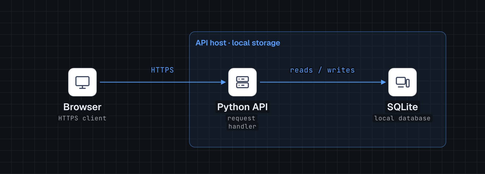

# Stack Story Skills

Independent Hermes skills for architecture diagrams and stack walkthrough videos. **Your existing `brag` skill is not modified, invoked, or required.**

- **Source implementation:** both skills and configuration/installation helpers implemented.
- **Offline checks:** 14 unittest tests passing.
- **Runtime acceptance:** both diagram themes rendered; 30-second landscape video composition passes HyperFrames browser checks. Final MP4 awaits preview approval.
- **Independent review:** no blocking findings; one deferred minor validation edge case ([review](docs/review.md)).



## Two skills, separate jobs

| Skill | Use it for | Outputs |
|---|---|---|
| `stack-diagram` | A static tech stack, architecture, or infrastructure diagram | Self-contained HTML; browser-exported light/dark PNGs; optional TSX |
| `stack-video` | Explaining components and request/data flow | Evidence manifest, resolved configuration, storyboard, editable HyperFrames composition, then MP4/poster after preview approval |

`stack-diagram` is adapted from [caru-ini/stack-diagram](https://github.com/caru-ini/stack-diagram). `stack-video` uses HyperFrames directly. It may reuse a checked diagram or request the sibling diagram skill; it does not route through brag. These are agent workflows, **not** a CLI that automatically discovers and renders any repository.

## Installation

Requires Python 3.9+ and Hermes Agent. From this repository:

```bash
python3 scripts/install.py
```

The destination is `$HERMES_HOME/skills`, or `~/.hermes/skills` when `HERMES_HOME` is unset. Set the correct active profile before installing. An explicit destination is also supported:

```bash
python3 scripts/install.py --skills-dir /path/to/profile/skills
python3 scripts/install.py --skill stack-diagram
python3 scripts/install.py --skill stack-video
```

The installer refuses existing skill names and symlink destinations; it does not overwrite or upgrade them. It stages copies before promotion and rolls back its own partial installation on Python exceptions. It is not crash-atomic or protected against concurrent filesystem writers: install into a quiescent profile. For an update, preserve your existing skill directories outside the skills catalog, remove them only after reviewing changes, then install again. Do not delete another profile's files.

Start a new Hermes session if the skill catalog is cached. Installation copies the skills and linked resources; it does **not** install Python packages, browsers, Node.js, FFmpeg or HyperFrames domain skills.

### Rendering prerequisites

- Diagram build/icon helpers: Python 3.9+, standard library.
- Diagram PNGs: a working Playwright installation and Chromium. An isolated environment avoids broken system Python packages:

```bash
python3 -m venv .venv
.venv/bin/python -m pip install playwright
.venv/bin/python -m playwright install chromium
```

The activation/interpreter paths above are POSIX examples; on Windows use the virtual environment's `Scripts/python.exe`.

- Video: Node.js 22+, FFmpeg/FFprobe, HyperFrames CLI and its Chromium. Install the separate `hyperframes-core`, `hyperframes-cli`, `hyperframes-animation`, and `hyperframes-creative` skills into the agent as well. They are not bundled here.
- Voice/music: optional, explicitly selected. Narration requires a functioning TTS route or supplied recording; music requires an existing decodable local file and permission to use it. Missing requested narration blocks final rendering rather than silently creating a silent video.

## Usage in Hermes

```text
Use stack-diagram to diagram this project. Cite evidence for the nodes and edges.

Use stack-video to explain this stack in a 30-second vertical walkthrough,
with a dark theme, music off, and no narration.

Use stack-video with this existing diagram. Explain the request path,
then finish on the full architecture. Leave brag alone.
```

For static diagrams only, `stack-video` and HyperFrames are unnecessary. For a video that needs a new static diagram, install both skills.

## Configure stack-video

Copy `examples/stack-video.json` into the target project as `stack-video.json`:

```json
{
  "format": "landscape",
  "duration": 30,
  "theme": "dark",
  "tone": "explanatory",
  "music": "off",
  "voice": false
}
```

| Field | Values | Default |
|---|---|---|
| `format` | landscape 1920×1080, vertical 1080×1920, square 1080×1080 | landscape |
| `duration` | finite number from 10 to 120 seconds | 30 |
| `theme` | light or dark | dark |
| `tone` | non-empty creative/technical direction | explanatory |
| `music` | `off` or existing local file path | off |
| `voice` | JSON boolean | false |

**Precedence:** explicit invocation overrides → project JSON → defaults. Unknown keys and invalid values are errors. The helper validates configuration; the agent must apply it to the composition. It does not transform the bundled landscape example into another aspect ratio automatically.

```bash
python3 skills/stack-video/scripts/config.py --config examples/stack-video.json
python3 skills/stack-video/scripts/config.py --config examples/stack-video.json \
  --format vertical --duration 45 --theme light --tone technical --no-voice
```

Use `--voice` to request narration, `--no-voice` to explicitly disable it, and `--music /path/to/track.wav` or `--music off`. JSON music paths are relative to the JSON file; CLI music paths are relative to the working directory. A path-existence check is not a codec or license check.

## Example and verification

The example is **illustrative**, not a diagram of a claimed deployed service. It uses only bundled generic pictograms; no vendor icon archive or fetched brand logo is redistributed.

- [Evidence](examples/demo/evidence.md), [graph](examples/demo/architecture.json), [storyboard](examples/demo/storyboard.md), [resolved configuration](examples/demo/resolved-config.json).
- [Self-contained diagram](examples/demo/diagram/stack.html), [light PNG](examples/demo/diagram/stack.png), [dark PNG](examples/demo/diagram/stack-dark.png).
- [Editable video source](examples/demo/composition/index.html). Open through HyperFrames Studio rather than directly as a file; the runtime owns the timeline registry and seeking.
- [Verification details and limitations](docs/verification.md).

```bash
python3 -m unittest discover -s tests -v
npx --yes hyperframes@0.9.19 check examples/demo/composition --snapshots
npx --yes hyperframes@0.9.19 preview examples/demo/composition --background
```

Review the Studio timeline first. Only after explicit approval:

```bash
npx --yes hyperframes@0.9.19 render examples/demo/composition \
  --quality delivery --workers 1 --output examples/demo/stack.mp4
ffprobe -v error -show_format -show_streams -of json examples/demo/stack.mp4
```

The initial composition compile resolves the pinned GSAP CDN script. Diagram HTML embeds its fonts and icons and works offline. Narration, music mixing, vertical/square compositions, logo fetching, and TSX conversion are not covered by the current silent-landscape runtime acceptance; their configuration/reference coverage is separate from end-to-end rendering.

## Privacy and publishing

A dependency does not establish a running service. The skills distinguish evidence, inference, and unknowns, and avoid reading secrets to discover architecture. Creating this public pack does not authorize uploading future projects, topology, screenshots, source, or audio. The optional upstream gallery requires its own explicit content review and consent. No gallery submission is made by installation.

## Structure

```text
skills/stack-diagram/     Upstream-based diagram workflow and tools
skills/stack-video/       Independent video workflow and configuration helper
scripts/install.py       Collision-safe installer
examples/demo/           Illustrative diagram and editable video
tests/                   Helper and example regression tests
docs/                    Design, plan, evaluations and verification
```

## Contributing

Keep the skills independently invokable, preserve upstream notices, add failing regression tests before changing helper behavior, and run the complete unittest suite. Test actual browser output before claiming a render works. Do not commit fetched vendor icon packages, credentials, local settings, caches or runtime reports containing personal paths.

## Licenses and author

Original diagram code/docs: MIT, copyright caru-ini; see [LICENSE](LICENSE), the skill's own notices and [UPSTREAM.md](UPSTREAM.md) for the exact source commit and adaptations. New pack code/docs: MIT, copyright Cory (hersaintel), see [LICENSE-PACK](LICENSE-PACK). Fonts retain their bundled SIL OFL 1.1 notices. Brand names and logos remain their owners' trademarks.

Maintained by [@hersaintel](https://github.com/hersaintel), with Hermes Agent. Thanks to caru-ini for the original stack-diagram skill and the HyperFrames project for the video rendering workflow.
